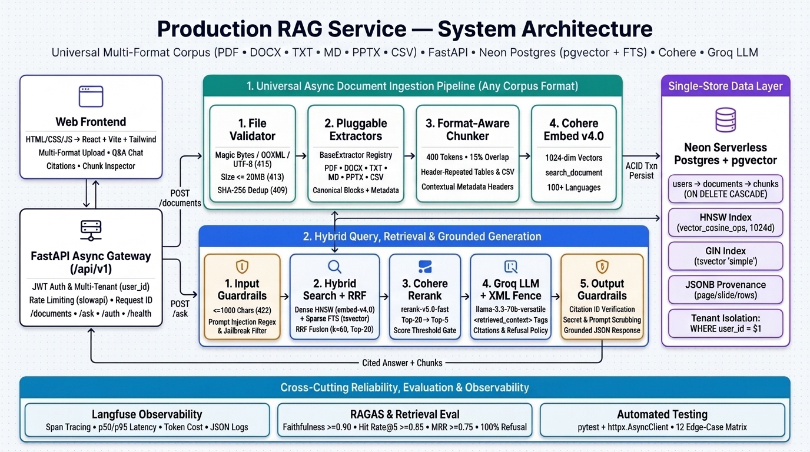

# System Design & Architectural Justifications (`DESIGN.md`)

This document explains every architectural decision made for the **Production RAG Service**, including alternatives evaluated and trade-offs across quality, cost, speed, latency, and operational complexity.

---

## 1. Layered Architecture & Separation of Concerns

All code is written natively in Python (zero no-code/drag-and-drop RAG builders) with strict boundaries:
- **HTTP Layer (`backend/app/api/v1/`, `main.py`, `schemas.py`)**: Pure request/response mapping, Pydantic v2 validation, rate limiting (`slowapi`), `X-Request-ID` middleware, and standardized JSON error envelopes. Zero business logic inside routes.
- **Ingestion Domain (`backend/app/ingestion/`)**: Validation (`validator.py`), pluggable format adapters (`extractors/`), format-aware chunking (`chunker.py`), async batched embeddings (`embedder.py`), and transactional orchestration (`pipeline.py`).
- **Retrieval & Generation Domains (`retrieval.py`, `generation.py`, `guardrails.py`)**: Hybrid search, RRF fusion, reranking, XML context fencing, grounded prompting, citation verification, and secret scrubbing.
- **Persistence Layer (`backend/app/db/`)**: Async SQLAlchemy 2.0 ORM (`models.py`), Neon-hardened connection pool (`session.py` with `pool_pre_ping=True`, `pool_recycle=300`), and idempotent SQL migrations (`schema.sql`, `migrate.py`).

---

## 2. Justified Design Decisions

### 2.1 Validation Corpus
- **Choice**: An 8-document multi-format corporate knowledge corpus in `data/corpus/` covering all 6 supported formats (`.pdf`, `.docx`, `.txt`, `.md`, `.pptx`, `.csv`) plus 4 adversarial/edge-case fixtures in `data/edge_cases/`.
- **Why it is a fair test**: Includes multi-page narrative policies with tables (`01_company_hr_policy.pdf`, `02_engineering_handbook.pdf`), an **intentional policy contradiction pair** (`03_remote_work_policy_2025.docx` vs `04_remote_work_addendum_2026.docx`), Markdown code fences & SLA tables (`05_incident_runbook.md`), security guidelines (`06_security_guidelines.txt`), a 4-slide deck with speaker notes & budget table (`07_q3_product_roadmap.pptx`), and a 36-row financial CSV (`08_regional_sales_2025.csv`).

### 2.2 Text Extraction Strategy
- **Choice**: Pluggable `BaseExtractor` + `ExtractorRegistry` emitting canonical `ExtractedDocument` / `ExtractedBlock` records:
  - **PDF**: `PyMuPDF` (`pymupdf`) with vertical margin clipping (`36pt`) to strip repeating headers/footers + `pdfplumber` for Markdown tables + `< 20 chars/page` scanned-PDF rejection (`400`).
  - **DOCX**: `python-docx` iterating OOXML body children in exact reading order so embedded tables stay attached to their parent heading.
  - **TXT / MD**: UTF-8 fast path + `chardet` fallback; Markdown heading-breadcrumb tree (`# > ## > ###`) respecting fenced code blocks.
  - **PPTX**: `python-pptx` extracting slide titles, body frames, embedded tables, and speaker notes (`slide_number` mapped to `page_number`).
  - **CSV**: `csv.Sniffer` delimiter auto-detection (`,`, `;`, `\t`, `|`) + header-only rejection (`400`).
- **Alternatives Rejected**: Single-library parsers (e.g., `pypdf` alone loses table layout; naive `.docx` paragraph/table loops lose reading order; naive CSV line splitting orphans numeric cells from headers).
- **Trade-off**: Slightly more modular code upfront, but adding new formats (`.xlsx`, `.html`, `.json`) requires registering one class with zero downstream pipeline changes.

### 2.3 Chunking Strategy
- **Choice**: **Config B** — `400`-token target (`tiktoken cl100k_base`), `60`-token overlap (`15%`), structure-aware recursive splitting (`paragraphs → sentences → token windows`), **header-repeated CSV/table row batching** (switching to `Column: Value` key-value records above 12 columns), and **contextual metadata header injection** (`[Document | Section | Page/Slide/Rows]`).
- **Alternative Evaluated**: **Config A** (`800` tokens, `120` overlap, no contextual headers).
- **Evidence**: As reported in [EVAL.md](EVAL.md), Config B outperformed Config A on the golden dataset (`Hit Rate@5`: `1.0000` vs `0.9444`, `Recall@5`: `0.9722` vs `0.9444`, `MRR`: `1.0000` vs `0.9074`) while keeping CSV batches cleanly bounded (`<= 397` tokens) with repeated column headers.

### 2.4 Embedding Model
- **Choice**: **Cohere Embed v4.0 (`embed-v4.0`)** via Cohere v2 API with Matryoshka `output_dimension=1024` and asymmetric `input_type="search_document"` vs `"search_query"`.
- **Alternatives Rejected**: Local `BAAI/bge-m3`, `all-MiniLM-L6-v2`, `Qwen3-Embedding-0.6B`.
- **Trade-offs**: 128K context window and 100+ native languages (enabling Urdu/Arabic cross-lingual retrieval over English docs) with zero local RAM/GPU pressure on cloud hosts; `output_dimension=1024` cuts Postgres HNSW memory by 33% vs the 1536 default while preserving recall. Trade-off is external API network dependency, mitigated via `tenacity` 3x retries, `asyncio.Semaphore` concurrency caps, and `503` error handling.

### 2.5 Vector Database
- **Choice**: **Neon Serverless Postgres + `pgvector`** (`HNSW` `vector_cosine_ops`, `m=16, ef_construction=64`) combined with native `tsvector('simple')` `GIN` indexing.
- **Alternatives Rejected**: Pinecone Serverless, Qdrant, Chroma.
- **Trade-offs**: Single-store ACID transactions eliminate dual-write sync bugs: `DELETE FROM documents` removes every vector chunk atomically via `ON DELETE CASCADE`, and multi-tenant filtering (`WHERE user_id = $1`) executes in a single query. `pgvector` HNSW delivers 5–50ms latency up to millions of vectors without managing a second datastore.

### 2.6 Retrieval Settings
- **Choice**: Hybrid dense (`pgvector` HNSW Top-20) + sparse (`tsvector` GIN `'simple'` Top-20) merged via **Reciprocal Rank Fusion (`k=60`)**, reranked via **Cohere `rerank-v5.0-fast`** to `top_k=5`.
- **Threshold Gating**: Distinct gates prevent score-scale bugs — `cosine_similarity >= 0.35` for Config A (`dense_only`), and calibrated `rerank_score >= 0.25` for Config B (`hybrid_rerank`), never applied to raw RRF scores (`~0.016–0.033`). Both `similarity_score` and `rerank_score` are returned to the frontend Chunk Inspector.
- **Trade-off**: Adds ~150–250ms for cross-encoder reranking, repaid with significantly higher MRR and cleaner off-topic refusal separation.

### 2.7 Primary LLM
- **Choice**: **Groq API (`llama-3.3-70b-versatile`)** at `temperature=0.0`, `max_tokens=1024`.
- **Alternatives Rejected**: Local Ollama (`Qwen2.5-7B` — too slow for 60+ eval runs and RAM-heavy), OpenAI `GPT-4o-mini` / Claude Haiku (higher cost/latency per query).
- **Trade-offs**: Sub-second TTFT (~250+ tokens/sec), 128K context window, strong instruction adherence for inline citations and multilingual answers, and low cost per question. Data privacy is protected by transmitting only top-5 minimal chunks (never raw files) and zero secret logging.

### 2.8 Prompt Design & Multi-Layer Guardrails
- **Input Guardrails**: Pydantic schema validation (`1..1000` chars → `422`), `slowapi` rate limiting (`30 req/min` → `429`), compiled regex/heuristic prompt-injection & jailbreak filter (`400`), and off-topic relevance threshold gating.
- **Document Fencing**: Retrieved chunks are wrapped in `<retrieved_context><chunk id="..." filename="..." page="...">` XML tags with embedded closing-tag escaping (`&lt;/retrieved_context&gt;`) to neutralize indirect prompt injection.
- **System Prompt**: Enforces exclusive context grounding, mandatory inline `[Chunk ID: <id> | <filename>, p. <page>]` citations, explicit presentation of conflicting sources, same-language answering, and exact refusal wording when evidence is insufficient.
- **Output Guardrails**: Parses every inline citation and strips any ID not in the retrieved set; scrubs sensitive patterns (`gsk_`, `postgres://`, `Bearer`, system-prompt leakage).

---

## 3. API Design & Testing Approach

- **REST Contract**: Versioned `/api/v1` endpoints (`GET /health`, `POST/GET/DELETE /documents`, `POST /ask`) with a single standardized `ErrorResponse` JSON envelope (`request_id`, `error_code`, `message`, `details`) across all error codes (`400`, `404`, `409`, `413`, `415`, `422`, `429`, `503`).
- **Testing Strategy**:
  1. **Notebook-First Prototyping (`notebooks/01..03`)**: Validated extraction, chunking distributions, hybrid RRF, XML fencing, and metrics step-by-step before freezing backend code.
  2. **Automated `pytest` Suite (`tests/`)**: `37` tests (`pytest` + `pytest-asyncio` + `httpx.AsyncClient`, `83%` backend coverage) covering unit logic (`validator`, all 6 extractors, `chunker`, `embedder` retries, `RRF`, `reranker`, `guardrails`, `evals`) and full async API integration contracts without requiring live external network calls.
