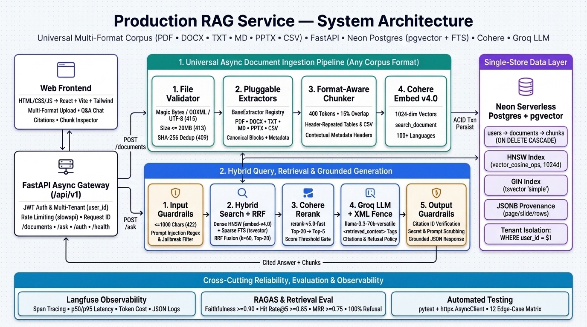

# Production RAG Service (`IEC-Portfolio1_RAG`)

> **Live Deployment (Render + Neon Postgres):**
> - **Web App (React + Tailwind SPA)**: https://production-rag-service.onrender.com/
> - **Swagger OpenAPI Docs**: https://production-rag-service.onrender.com/docs
> - **Health Check**: https://production-rag-service.onrender.com/api/v1/health
> - **Operational Metrics (`p50`/`p95`, tokens, cost)**: https://production-rag-service.onrender.com/api/v1/metrics
>
> *(Note: Hosted on Render Free Tier — if the service was idle for >15 minutes, the first request takes ~30–50 seconds to wake up.)*

A production-grade, code-first Retrieval-Augmented Generation (RAG) service engineered with **FastAPI**, **Neon Serverless Postgres (`pgvector` HNSW + `tsvector` GIN)**, **Cohere Embed v4.0 & Rerank v5.0-fast**, **Groq (`openai/gpt-oss-120b`)**, **JWT multi-tenant authentication**, multi-layer security guardrails, a **React + Vite + Tailwind SPA** with a **Retrieved Chunks Inspector**, automated `pytest` suites, and a reproducible evaluation harness.



---

## Key Capabilities

- **Universal Multi-Format Ingestion (6 Formats)**: Pluggable `BaseExtractor` + `ExtractorRegistry` supporting `.pdf`, `.docx`, `.txt`, `.md`, `.pptx`, and `.csv` with magic-byte/OOXML/UTF-8 signature validation (`415`), 20 MB cap (`413`), SHA-256 deduplication (`409`), and scanned-PDF/header-only CSV rejection (`400`).
- **Format-Aware Chunking**: Recursive token splitting (`tiktoken cl100k_base`), atomic/header-repeated Markdown tables, header-repeated CSV row batching (`Column: Value` records for wide CSVs > 12 columns), and contextual metadata header injection (`[Document | Section | Page/Slide/Rows]`).
- **Single-Store Hybrid Retrieval**: Neon Postgres stores relational metadata, 1024-dim dense vectors (`HNSW` `vector_cosine_ops`), and sparse full-text vectors (`GIN` `tsvector('simple')`) in one ACID database (`ON DELETE CASCADE`, `WHERE user_id = $1`). Combines dense + sparse via **Reciprocal Rank Fusion (`k=60`)** and **Cohere `rerank-v5.0-fast`**.
- **Grounded Generation & Multi-Layer Guardrails**: Input length/prompt-injection/jailbreak screening, `<retrieved_context>` XML document fencing with breakout escaping, strict inline citations (`[Chunk ID: <id> | <filename>, p. <page>]`), contradiction reporting, deterministic refusals, outbound citation ID verification, and secret scrubbing.
- **JWT Authentication & Multi-Tenancy**: Argon2id password hashing (`pwdlib[argon2]`) + HS256 JWT Bearer tokens (`PyJWT`) isolating every user’s documents and vector chunks, plus one-click **Load Sample Corpus** (`POST /api/v1/documents/load-sample-corpus`).
- **Modern React + Vite + Tailwind SPA**: Split-screen auth, multi-file drag-and-drop uploader, document search/filter, clickable inline citation pills that highlight and scroll to the exact chunk in the **Retrieved Chunks Inspector** (with Cosine, RRF, and Rerank score bars), and a live **Telemetry** popover (`p50`/`p95` latency, error rate, token usage, cost, Langfuse status).

---

## Project Structure

```text
IEC-Portfolio1_RAG/
├── .env.example                 # Secret-free environment variable contract
├── requirements.txt             # Pinned full dev/eval dependencies (==)
├── requirements-prod.txt        # Lean pinned runtime dependencies for Render Docker
├── Dockerfile                   # 2-stage build (Node React SPA + Python 3.12 FastAPI)
├── render.yaml                  # Render Free Tier Infrastructure Blueprint
├── pyproject.toml               # pytest-asyncio & Ruff configuration
├── README.md                    # Live URL, setup, run, test, and evaluation guide
├── DESIGN.md                    # Architecture & justified design decisions
├── EVAL.md                      # Golden set, Config A vs B benchmarks & failure analysis
├── docs/
│   ├── architecture.png         # End-to-end system architecture blueprint
│   ├── app_detail.pdf           # Concise 6-page technical guide & rubric checklist
│   └── plan_build.html          # Master architecture & build plan
├── backend/app/
│   ├── config.py                # Pydantic BaseSettings + Neon asyncpg URL normalizer
│   ├── schemas.py               # Strict Pydantic v2 request/response contracts
│   ├── auth.py                  # Argon2id password hashing & HS256 JWT utilities
│   ├── guardrails.py            # Input, XML fencing & output citation/secret guardrails
│   ├── retrieval.py             # Hybrid HNSW + TSVector + RRF + Cohere Rerank
│   ├── generation.py            # Grounded Groq LLM generator & refusal logic
│   ├── observability.py         # X-Request-ID, JSON logs, p50/p95 metrics & Langfuse hooks
│   ├── main.py                  # FastAPI app, error handlers & built React SPA mount
│   ├── db/                      # schema.sql, models.py, session.py, migrate.py
│   ├── ingestion/               # validator.py, extractors/, chunker.py, embedder.py, pipeline.py
│   └── api/v1/                  # Thin HTTP routes: auth, health/metrics, documents, ask, router
├── frontend/                    # React + TypeScript + Vite + Tailwind SPA
├── notebooks/                   # Executed Milestone 3 validation notebooks (01, 02, 03)
├── data/                        # 8-file multi-format corpus & 4 edge-case fixtures
├── evals/                       # golden_dataset.json (30 cases), run_eval.py, results/
└── tests/                       # 42 pytest unit & httpx.AsyncClient integration tests
```

---

## Local Setup & Configuration

### 1. Create Virtual Environment & Install Pinned Dependencies

```powershell
python -m venv .venv
.\.venv\Scripts\python.exe -m pip install -r requirements.txt
npm --prefix frontend install
npm --prefix frontend run build
```

### 2. Configure Environment Variables

Copy `.env.example` to `.env` and populate your Neon Postgres, Cohere, and Groq credentials (`.env` is gitignored):

```powershell
Copy-Item .env.example .env
```

Required variables for live execution:
- `DATABASE_URL` — Neon Serverless Postgres connection string (`postgresql://...` is automatically normalized to `postgresql+asyncpg://` with TLS)
- `COHERE_API_KEY` — Cohere v2 API key (`embed-v4.0` + `rerank-v5.0-fast`)
- `GROQ_API_KEY` — Groq API key (`openai/gpt-oss-120b`)
- `JWT_SECRET_KEY` — Strong random secret for HS256 JWT signing

### 3. Provision Schema & Indexes on Neon Postgres

```powershell
.\.venv\Scripts\python.exe -m backend.app.db.migrate
```

---

## Running Locally

```powershell
.\.venv\Scripts\python.exe -m uvicorn backend.app.main:app --reload --port 8000
```

- **Web Frontend & Chunk Inspector**: `http://127.0.0.1:8000/`
- **Interactive Swagger API Docs**: `http://127.0.0.1:8000/docs`

### API Endpoints

| Method | Path | Auth | Success | Error Codes | Purpose |
| --- | --- | --- | --- | --- | --- |
| `GET` | `/api/v1/health` | Public | `200 OK` | `503` | Verify Postgres & `pgvector` health |
| `GET` | `/api/v1/metrics` | Public | `200 OK` | — | Rolling `p50`/`p95` latency, error rate, tokens & cost |
| `POST` | `/api/v1/auth/signup` | Public | `201 Created` | `409`, `422` | Register Argon2 user & issue JWT |
| `POST` | `/api/v1/auth/login` | Public | `200 OK` | `401`, `422` | Authenticate & issue JWT Bearer token |
| `GET` | `/api/v1/auth/me` | JWT | `200 OK` | `401` | Return current authenticated user profile |
| `POST` | `/api/v1/documents` | JWT | `201 Created` | `400`, `401`, `409`, `413`, `415`, `503` | Validate, extract, chunk, embed & store |
| `POST` | `/api/v1/documents/load-sample-corpus` | JWT | `201 Created` | `401`, `404` | Load 8-file 6-format sample corpus into user workspace |
| `GET` | `/api/v1/documents` | JWT | `200 OK` | `401`, `422` | Paginated list of user’s documents |
| `DELETE` | `/api/v1/documents/{id}` | JWT | `204 No Content` | `401`, `404` | Delete document & cascade all chunks |
| `POST` | `/api/v1/ask` | JWT | `200 OK` | `400`, `401`, `422`, `429`, `503` | Guardrailed hybrid retrieval & cited Q&A |

---

## Running Tests, Notebooks & Evaluation

```powershell
# Run linter (0 errors)
.\.venv\Scripts\python.exe -m ruff check backend evals scripts tests

# Run full pytest suite with coverage (42 tests · 83% backend coverage)
.\.venv\Scripts\python.exe -m pytest --cov=backend/app --cov-report=term-missing -v

# Run reproducible evaluation harness (Config A vs Config B)
.\.venv\Scripts\python.exe -m evals.run_eval

# Launch JupyterLab to inspect/re-run Milestone 3 validation notebooks
.\.venv\Scripts\python.exe -m jupyter lab
```

See [DESIGN.md](DESIGN.md) for all architecture justifications, [EVAL.md](EVAL.md) for measured benchmark results, and [docs/app_detail.pdf](docs/app_detail.pdf) for the concise technical guide and rubric checklist.
